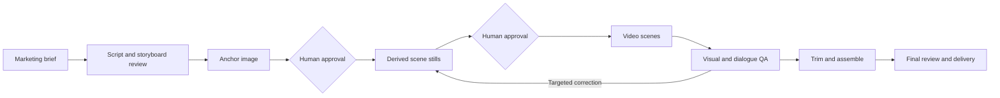

# AI Creative Production Pipeline

**From marketing brief to reviewable AI video ads — with explicit human approval gates.**

A portfolio project by [Eduardo Ayala](https://github.com/eduardoayalaq04), built around a real agent-assisted creative production workflow developed for Simplixy.

This repository separates two things deliberately:

1. **Production methodology:** reusable directing instructions, review checklists, and engineering lessons from image/video campaigns.
2. **Executable reference implementation:** a newly extracted Python workflow that demonstrates dependency planning, approval gates, resumable state, and provider request construction without spending API credits.

> The default demo creates labeled **mock JSON records**, not images or video. This version does not call a live generation API, run speech recognition, or render a final edit. Those steps are documented as the original tool-assisted workflow, not misrepresented as shipped automation.

## Why this exists

Generating one attractive clip is not the same as producing a usable ad. Multi-scene production introduces identity drift, inconsistent voices, cut-off dialogue, unclear gestures, failed jobs, and duplicate spend when interrupted runs are restarted.

The approach treats creative work as a dependency graph with reviewable artifacts. An approved character/style anchor feeds derived stills; approved stills feed individual video scenes; scenes undergo dialogue and visual review before editing.

## Architecture



**Implemented in the CLI:** DAG validation, mock asset records, persisted state, explicit approvals, resume safeguards, and pure APIMart request builders. See [architecture and boundaries](docs/architecture.md).

## Run the no-cost demo

Requires Python 3.9+. No runtime dependencies, API key, installation, or network access needed. Run from the repository root:

```bash
python3 -m creative_pipeline plan examples/campaign.json --out runs/demo
python3 -m creative_pipeline run examples/campaign.json --out runs/demo --provider mock
```

Only `IMG_A` completes initially. Downstream assets stay pending until you explicitly approve their inputs:

```bash
python3 -m creative_pipeline approve runs/demo IMG_A --reviewer demo-reviewer
python3 -m creative_pipeline run examples/campaign.json --out runs/demo
python3 -m creative_pipeline approve runs/demo IMG_B --reviewer demo-reviewer
python3 -m creative_pipeline run examples/campaign.json --out runs/demo
```

Now all three mock records exist. You can approve the final scene record as well:

```bash
python3 -m creative_pipeline approve runs/demo ESC_1 --reviewer demo-reviewer
python3 -m unittest discover -v
```

Inspect `runs/demo/manifest.json` and `runs/demo/assets/`. Repeating `run` skips completed records. Editing the campaign requires a **new output directory**; the same run fails closed rather than silently replacing an approved asset. These demo approvals demonstrate state transitions, not actual media acceptance.

## What to explore

- [Reusable production skill](skills/creative-production/SKILL.md): creative direction, approval gates, continuity, and targeted rerolls.
- [Architecture](docs/architecture.md): what runs today versus what remains manual or future work.
- [QA rubric](docs/quality-rubric.md): dialogue, visual continuity, props, gestures, and edit validation.
- [Case study](docs/case-study.md): practical problems and decisions from the Simplixy workflow.
- [Security and publishing](docs/security.md): personal/work separation and safe assets.
- `creative_pipeline/apimart.py`: pure image/video request builders and nested result URL extraction.
- `tests/`: behavioral tests for invalid DAGs, gates, resume, and provider contracts.
- `docs/ci-workflow-template.yml`: optional GitHub Actions template for Python 3.9/3.12. CI is **not enabled** in this initial upload because the personal OAuth authorization lacks the `workflow` scope. After separately authorizing that scope, move the template to `.github/workflows/tests.yml`.

## Applied AI and GTM relevance

**Applied AI:** API contract modeling, dependency orchestration, persistent state, conservative recovery, and separating provider success from semantic quality.

**GTM engineering:** translating a marketing objective into a structured creative brief and reusable production recipe. This project covers creative operations, **not** CRM integration, prospecting, campaign deployment, attribution, or validated conversion lift.

## Authorship and evidence

Eduardo defined the business objective, creative direction, approval requirements, and acceptance criteria through iterative production. AI assistants supported prompting, coding, troubleshooting, and documentation. The reference implementation was prepared with AI assistance and checked with automated tests and a local CLI walkthrough.

No fabricated ROI, time savings, conversion metrics, customer testimonials, or production benchmarks are claimed. Historical media and private metadata are not bundled. A publishable media showcase is pending asset-rights review; the executable demo is the workflow demonstration currently available.

## Current limitations

- Only `mock` execution is supported; APIMart helpers do not perform HTTP calls.
- No live provider compatibility test was performed for this repository.
- Mock resume behavior does not guarantee exactly-once submission to an external paid service.
- Approvals are local audit entries, not authenticated multi-user authorization.
- Visual/voice QA and FFmpeg/Whisper production steps are documented, not CLI features.
- This is a local reference implementation, not a distributed production platform.
- No open-source license has been selected. Repository visibility does not grant a license to reuse its contents.
