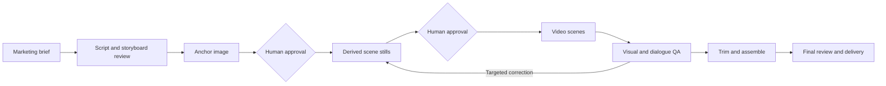

# AI Creative Production Pipeline

**From marketing brief to reviewable AI video ads — with explicit human approval gates.**

## Video showcase

### Real estate · two-presenter podcast

[](examples/Real%20State.mp4)

[Watch video](examples/Real%20State.mp4) · 48.1 seconds · 720 × 1280 · audio included. Demonstrates a two-character continuity and scene-direction challenge.

### Beauty · UGC-style creative

[](examples/acne_makeup_ugc.mp4)

[Watch video](examples/acne_makeup_ugc.mp4) · 36.6 seconds · 720 × 1280 · audio included. A product-oriented format highlighting face, skin, product and hand continuity.

### AI avatar · conversational lifestyle

[](examples/ai_avatar.mp4)

[Watch video](examples/ai_avatar.mp4) · 36.8 seconds · 720 × 1280 · audio included. A character-led format requiring consistent identity, wardrobe, room and props.

**Showcase scope:** These owner-authorized, AI-generated, bot-assembled exports come from the original agent-assisted workflow, not the Python mock runner. Final CapCut editing and subtitles are a separate finishing stage. All examples are synthetic, not real customer testimonials, clinical evidence, product-efficacy evidence, financing offers, institutional endorsements or verified service promises. Dialogue about results and customer experiences is fictional advertising copy. Metadata was measured with FFprobe.

## Why this exists

Generating one attractive clip is not the same as producing a usable ad. Multi-scene production introduces identity drift, inconsistent voices, cut-off dialogue, unclear gestures, failed jobs, and duplicate spend when interrupted runs are restarted.

The approach treats creative work as a dependency graph with reviewable artifacts. An approved character/style anchor feeds derived stills; approved stills feed individual video scenes; scenes undergo dialogue and visual review before editing.

## Architecture



**Implemented in the CLI:** DAG validation, mock asset records, persisted state, explicit approvals, resume safeguards, and pure APIMart request builders. See [architecture and boundaries](docs/architecture.md).

## Run the no-cost demo

Requires Python 3.9+. No runtime dependencies, API key, installation, or network access needed. Run from the repository root:

```bash
python3 -m creative_pipeline plan examples/campaign.json --out runs/demo
python3 -m creative_pipeline run examples/campaign.json --out runs/demo --provider mock
```

Only `IMG_A` completes initially. Downstream assets stay pending until you explicitly approve their inputs:

```bash
python3 -m creative_pipeline approve runs/demo IMG_A --reviewer demo-reviewer
python3 -m creative_pipeline run examples/campaign.json --out runs/demo
python3 -m creative_pipeline approve runs/demo IMG_B --reviewer demo-reviewer
python3 -m creative_pipeline run examples/campaign.json --out runs/demo
```

Now all three mock records exist. You can approve the final scene record as well:

```bash
python3 -m creative_pipeline approve runs/demo ESC_1 --reviewer demo-reviewer
python3 -m unittest discover -v
```

Inspect `runs/demo/manifest.json` and `runs/demo/assets/`. Repeating `run` skips completed records. Editing the campaign requires a **new output directory**; the same run fails closed rather than silently replacing an approved asset. These demo approvals demonstrate state transitions, not actual media acceptance.

## What to explore

- [Reusable production skill](skills/creative-production/SKILL.md): creative direction, approval gates, continuity, and targeted rerolls.
- [Architecture](docs/architecture.md): what runs today versus what remains manual or future work.
- [QA rubric](docs/quality-rubric.md): dialogue, visual continuity, props, gestures, and edit validation.
- [Case study](docs/case-study.md): practical problems and decisions from the Simplixy workflow.
- [Security and publishing](docs/security.md): personal/work separation and safe assets.
- `creative_pipeline/apimart.py`: pure image/video request builders and nested result URL extraction.
- `tests/`: behavioral tests for invalid DAGs, gates, resume, and provider contracts.
- `docs/ci-workflow-template.yml`: inactive GitHub Actions template for Python 3.9/3.12. CI is **not enabled**. Before enabling it, review its permissions, pin third-party actions to reviewed immutable commits, and move it to `.github/workflows/tests.yml`.

## Applied AI and GTM relevance

**Applied AI:** API contract modeling, dependency orchestration, persistent state, conservative recovery, and separating provider success from semantic quality.

**GTM engineering:** translating a marketing objective into a structured creative brief and reusable production recipe. **Focus: creative operations for paid acquisition**, from structured briefs to reviewable assets and repeatable production recipes. Campaign performance is not measured by this repository.

## Evidence and design decisions

- **Creative evidence:** three reviewable video examples above, produced with the original Simplixy workflow under Eduardo's creative direction.
- **Executable evidence:** the no-cost CLI demonstrates DAG validation, explicit approvals, persistent state and conservative resume behavior using labeled mock JSON records.
- **Approval before spend:** an approved anchor feeds scene stills; approved stills unlock video scenes. The reference runner models those dependencies without generating paid media.
- **Targeted correction:** the production playbook treats continuity and dialogue QA as acceptance criteria, with rerolls focused on the affected scene rather than the whole sequence.
- **Honest provider boundary:** APIMart helpers construct requests; they do not submit jobs. Local mock recovery is not evidence of exactly-once paid generation.

## Limitations

- The CLI supports **mock execution only**: no live generation API calls or provider compatibility validation. Request builders are pure helpers.
- Resume safeguards are local; they do not guarantee exactly-once submission to external paid services. This is not a distributed production platform.
- Approvals are local audit entries, not authenticated multi-user authorization. Run directories must be trusted and symlink-free; schema 1 manifests require a new output directory.
- Visual/voice QA, FFmpeg/Whisper processing and final editing belong to the documented production workflow, not shipped CLI automation.
- No campaign lift, ROI, cost-per-finished-video or production throughput benchmark is claimed. Hosted CI is not enabled; an inactive template is linked above.

See [architecture and implementation boundaries](docs/architecture.md) and [security notes](docs/security.md).

## Authorship and license

Eduardo Ayala defined the business objective, creative direction, workflow requirements and acceptance criteria. AI tools assisted with production, implementation, troubleshooting and documentation.

Repository code, tests, configuration and documentation are [MIT licensed](LICENSE). Showcase videos and previews are excluded; see [media rights](examples/MEDIA_RIGHTS.md).
